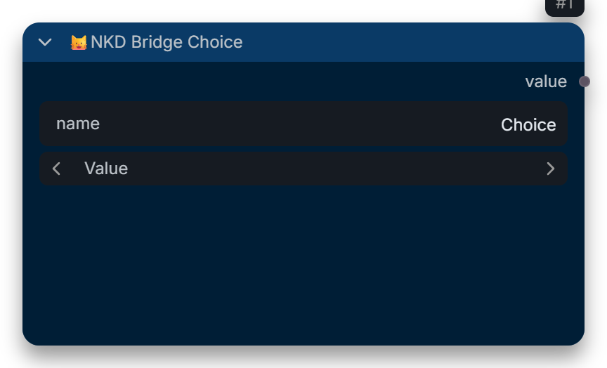
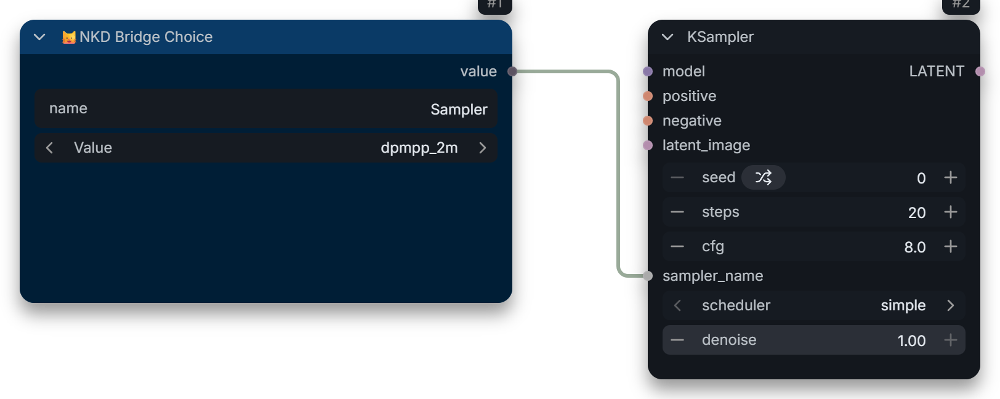

# 😺NKD Bridge Choice

A dropdown or an on/off switch in the Photoshop panel. Connect its output to any list input (a sampler's `sampler_name` or `scheduler`, a switch node's options…) or to a boolean input: it takes that input's options and current value, and the panel shows them as a list, or as a checkbox for a boolean.

 

- `name`: the label in the panel.
- **Value**: the option chosen. Picking another one in the panel writes it here, like the Number slider.
- Its options are saved with the node, so they stay if you disconnect it. Reconnect it to another input to take that input's options.

---

[← All 😺NKD Comfy Bridge nodes](../README.md)
