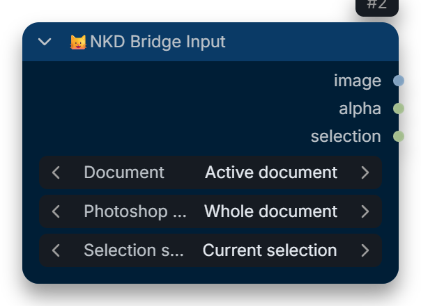
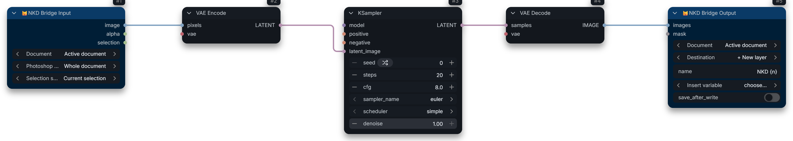

# 😺NKD Bridge Input

What to read from Photoshop: the whole document, or one layer or group that stays the same no matter which layer is active while you paint.

 

- **Document**: which Photoshop document to read. **Active document** (the default) follows whatever you're working in. Pick an open document from the list to always read that one, even while another is active. It's bound by id and, when you reopen it in another session, by name. **Use active** in the panel sets it too.
- **Photoshop source**: **Whole document** (the default) is every visible layer merged, the way you see it. Or pick a layer or group from the list (groups end in `/`), or select it in Photoshop and press **Use active** in the panel; **Document** in the panel goes back to the whole document. A layer is bound by id, so renaming it keeps the binding; if the id is gone (another document), the layer's path is used instead.
- `image`, `alpha`: the pixels and transparency, placed where they sit in the document, so a layer lines up with the whole document and with the selection.
- `selection`: a mask at document size, white where selected and black everywhere else. It doesn't depend on **Photoshop source**. Photoshop only sends it while this output is connected, so a workflow that doesn't use it isn't re-run when you select something.
- **Selection source**: what `selection` holds. **Current selection** (the default) is the live selection or Quick Mask; with nothing selected it's all black. Or pick a saved selection: an alpha channel (`Channel: Face`) or a path (`Path: Outline`), so mattes you prepared beforehand go straight into the workflow. You choose it in the Photoshop panel, from the dropdown under the input, so switching mattes while you retouch never takes you back to ComfyUI; the node has the same list. Saved ones are bound by id like layers, and reading them leaves your own selection and history untouched. A path is read anti-aliased, with no feather.
- A group arrives as Photoshop would flatten it: only its visible layers, with their opacity and blend modes. Your document and its history are left untouched.

## Inpainting a selection

Use **😺NKD Inpaint Crop** and **😺NKD Inpaint Stitch** from [NKD Basic Tools](https://github.com/Nekodificador/ComfyUI-NKD-Basic-Tools): they crop around the mask at the model's resolution and blend the result back.

1. Bridge Input's `image` and `selection` go into Inpaint Crop's `image` and `mask`.
2. Sample the crop, then give it to Inpaint Stitch with Inpaint Crop's `crop_data`.
3. Stitch's `image` goes to Bridge Output, with the same `selection` in Output's `mask`: the new layer is transparent outside the selection, so only the selected area changes.

---

[← All 😺NKD Comfy Bridge nodes](../README.md)
