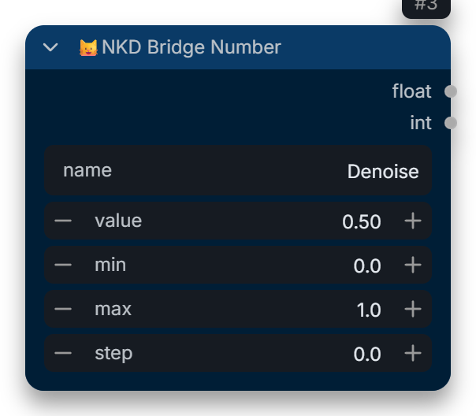
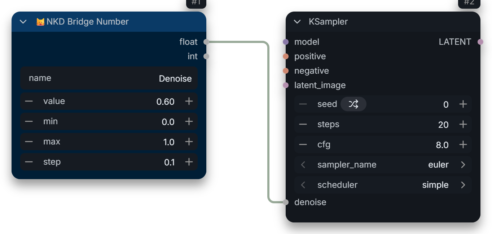
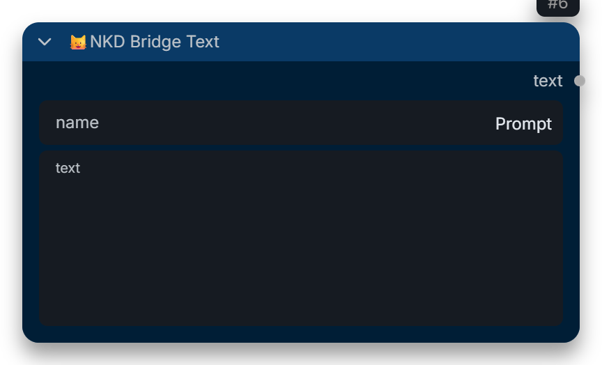
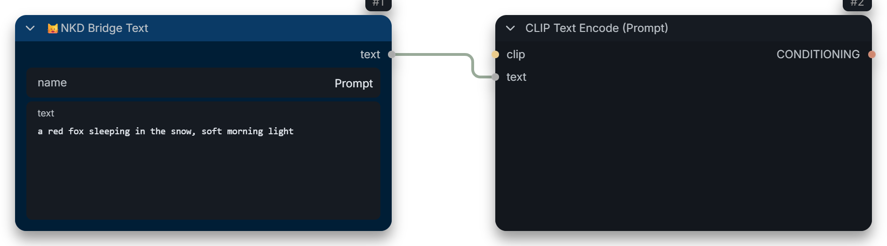

# 😺NKD Bridge Number / 😺NKD Bridge Text

Each one shows up in the Photoshop panel as a control named after `name`: a slider for Number, a text box for Text. Drag a control by its ⋮⋮ grip to put the panel in the order you want; the order is saved with the workflow. Moving the slider writes the value into the node in your ComfyUI tab, so what you see in both places is always the same value, and it's saved with the workflow.

## Bridge Number

- `name`: the label in the panel.
- `value`, `min`, `max`, `step`: the slider.
- Outputs both `float` and `int` (rounded), so it can drive denoise or a seed.

 

## Bridge Text

- `name`: the label in the panel.
- `text`: the text. Outputs it as a string.

 

---

[← All 😺NKD Comfy Bridge nodes](../README.md)
