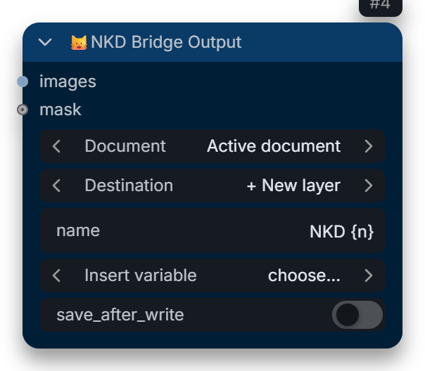
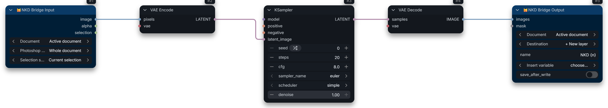

# 😺NKD Bridge Output

Sends the image back to Photoshop. It runs on every execution, even when nothing upstream changed, so pressing Generate always delivers. Whatever the destination, the result also shows up in the panel.

 

- `images`: what to send. Only the first image of a batch is used. An image with transparency (RGBA, like a cutout) keeps it in the layer.
- **Document**: where the result goes. **Active document** (the default) sends it back to the document its pixels came from. Pick another open document to paint in one and get the result in the other, for example a smart object's contents. The result is scaled to fit that document's canvas.
- `save_after_write`: saves that document after writing. Turn it on when it's a smart object's contents (the `.psb` that opens when you edit it), so the smart object in the parent document updates by itself.
- **Destination**: one list that decides where the result goes. What you pick sets the behaviour:
  - **Panel only**: shown in the panel, the document isn't touched. **To canvas ▸** in the panel adds it as a new layer.
  - **+ New layer**: creates a layer on the first run, and from then on the node is bound to that layer.
  - **+ New group**: creates a group on the first run and binds to it.
  - A layer (`Background`, `Character/Hair`): replaced on every run.
  - A group, shown with a trailing slash (`Characters/`): a new layer inside on every run, so you keep the variations side by side. While **Live** is on, the latest one is replaced instead, so painting doesn't pile up layers.
- `name`: how the layers it creates are called. **Insert variable** adds one at the end:
  - `{n}`: one more than the highest number already used by that name next to it (in the group, or at the top of the document), so every new layer gets its own number.
  - `{seed}`: the sampler's seed.
  - `{date}`, `{time}`: when it ran.
  - `{doc}`: the document's name.
  - Any Bridge Text or Bridge Number by its name, such as `{Prompt}` or `{Denoise}`. Long values are cut to 40 characters.
- `mask` (optional): transparency for the written layer. Give it Bridge Input's `selection` and only the selected area changes. A mask that's all black, as `selection` is with nothing selected, is ignored and the whole image is written (with an RGBA image, the mask cuts its own transparency further), so an inpaint workflow still works when you don't need a selection.

The destination is bound by id, like Bridge Input, so renaming the layer or group doesn't break it. If it gets deleted, the next run creates it again. With **Active document**, the result goes back to the document its pixels came from, even if you've switched to another one while it was generating. If the target document has been closed, nothing is written and the panel tells you.

## Painting in one document, results in another

Set Bridge Input's **Document** to the one you paint in and Bridge Output's **Document** to the one that should receive the result. A smart object works well as the target: edit its contents once so its `.psb` is open, pick it in the Output, and tick `save_after_write`. Live only re-runs when you change the document an Input reads, so working on the target never triggers a run.

In the panel's **Inputs & outputs** tab every Output has its own ▶ to run just that branch, a line saying where the result will land, **Use active** to send it to the layer or group selected in Photoshop, **Panel only**, and the name field with the variables as clickable chips.

---

[← All 😺NKD Comfy Bridge nodes](../README.md)

---

[← All 😺NKD Comfy Bridge nodes](../README.md)
