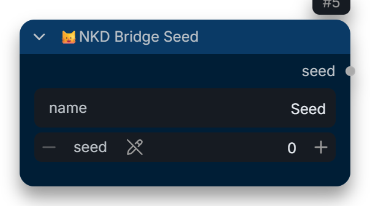
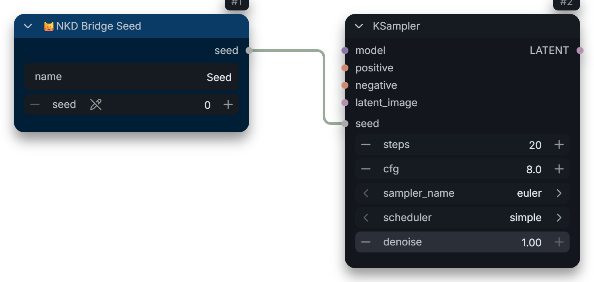

# 😺NKD Bridge Seed

A seed you control from the Photoshop panel. Connect its `seed` output to a sampler's seed.

 

- `name`: the label in the panel, and the `{Seed}` variable for naming layers (`{seed}` works too).
- `seed`: the number. In the panel you can type one, or press 🎲 for a new random one.
- After each run: **Fixed** keeps it (the default, best for Live), **Random** rolls a new one, **+1** and **−1** step it. It's the same setting as a sampler's *control after generate*.

---

[← All 😺NKD Comfy Bridge nodes](../README.md)
