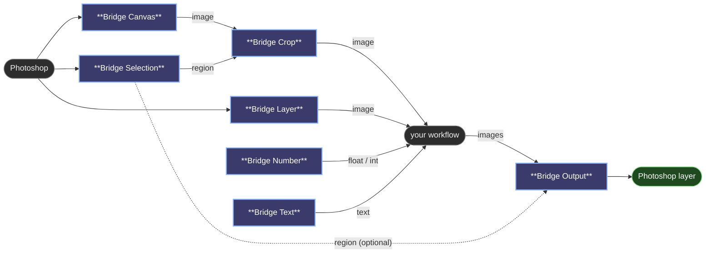

# Bridge nodes

The nodes come in two halves. Source nodes (Canvas, Layer, Selection) bring pixels in from Photoshop, and Bridge Output sends the result back. Number and Text turn into controls in the Photoshop panel. Put each one wherever your workflow needs that piece: there's no single "Photoshop node" that everything has to hang from.

Photoshop only sends what the open workflow uses, and only when it changes. A Layer node whose layer you didn't touch keeps its previous output, so ComfyUI skips everything downstream of it.

## Bridge Canvas

The whole visible document, every visible layer merged, the way you see it.

- `image`: the document as RGB.
- `alpha`: its transparency (white where something is painted).

## Bridge Layer

One layer or group, always the same one, no matter which layer is active while you paint. A group arrives merged.

- **Photoshop layer**: pick the layer or group from this list on the node (groups end in `/`), or select it in Photoshop and press **Use active** in the panel. It's bound by id, so renaming the layer keeps the binding; if the id is gone (another document), the layer's path is used instead.
- `image`, `alpha`: the layer's pixels and transparency, placed where they sit in the document, so they line up with Canvas and Selection.
- A group arrives as Photoshop would flatten it: only its visible layers, with their opacity and blend modes. Your document and its history are left untouched.

## Bridge Selection

The current selection, or Quick Mask, as a mask. It doesn't care which layer is active, so you can bind a group in one node and use a selection somewhere unrelated in another.

- `padding`: grows the box around the selection, in pixels, to give an inpaint some context.
- `mask`: the selection, document sized.
- `region`: the box around it. Give it to Bridge Crop to work on just that area, and to Bridge Output so the result goes back to the same place.

With nothing selected, the mask is empty and the region covers the whole document.

## Bridge Crop

Cuts an image, and optionally a mask, down to a Selection region. That's how you inpaint a small area at full detail instead of the whole canvas.

- `image`, `region`, `mask` (optional) in; the cropped `image` and `mask` out. Without a mask input, the mask comes out fully white.

## Bridge Number and Bridge Text

Each one shows up in the Photoshop panel as a control named after `name`: a slider for Number, a text box for Text. Moving the slider writes the value into the node in your ComfyUI tab, so what you see in both places is always the same value, and it's saved with the workflow.

Number:
- `name`: the label in the panel.
- `value`, `min`, `max`, `step`: the slider.
- Outputs both `float` and `int` (rounded), so it can drive denoise or a seed.

Text:
- `name`: the label in the panel.
- `text`: the text. Outputs it as a string.

## Bridge Output

Sends the image back to Photoshop. It runs on every execution, even when nothing upstream changed, so pressing Generate always delivers. Whatever the destination, the result also shows up in the panel.

- `images`: what to send. Only the first image of a batch is used.
- **Destination**: one list that decides where the result goes. What you pick sets the behaviour:
  - **Panel only**: shown in the panel, the document isn't touched. **Add preview as layer** can keep it.
  - **+ New layer**: creates a layer on the first run, and from then on the node is bound to that layer.
  - **+ New group**: creates a group on the first run and binds to it.
  - A layer (`Background`, `Character/Hair`): replaced on every run.
  - A group, shown with a trailing slash (`Characters/`): a new layer inside on every run, so you keep the variations side by side. While **Live** is on, the latest one is replaced instead, so painting doesn't pile up layers.
- `name`: how the layers it creates are called. **Insert variable** adds one at the end:
  - `{n}`: the run number inside the group (1, 2, 3…).
  - `{seed}`: the sampler's seed.
  - `{date}`, `{time}`: when it ran.
  - `{doc}`: the document's name.
  - Any Bridge Text or Bridge Number by its name, such as `{Prompt}` or `{Denoise}`. Long values are cut to 40 characters.
- `mask` (optional): transparency for the written layer.
- `region` (optional): from Bridge Selection. The result is scaled to that box and pasted there instead of over the whole document.

The destination is bound by id, like Bridge Layer, so renaming the layer or group doesn't break it. If it gets deleted, the next run creates it again. The result always goes back to the document its pixels came from, even if you've switched to another one while it was generating; if that document has been closed, nothing is written and the panel tells you.

In the panel's **Inputs & outputs** tab every Output has its own ▶ to run just that branch, a line saying where the result will land, **Use active** to send it to the layer or group selected in Photoshop, **Panel only**, and the name field with the variables as clickable chips.

---

[← All 😺NKD Comfy Bridge nodes](../README.md)
