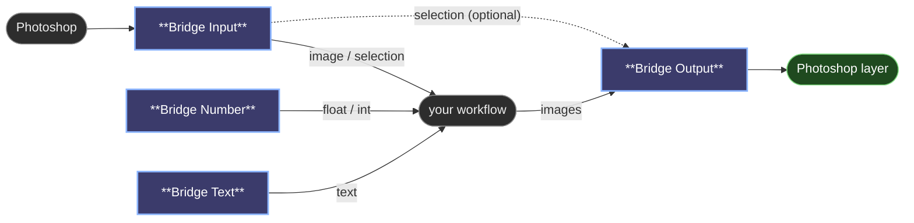

# Bridge nodes

The nodes come in two halves. Bridge Input brings pixels in from Photoshop, and Bridge Output sends the result back. Number, Text, Choice and Seed turn into controls in the Photoshop panel. Put each one wherever your workflow needs that piece: there's no single "Photoshop node" that everything has to hang from.

Photoshop only sends what the open workflow uses, and only when it changes. An Input node whose layer you didn't touch keeps its previous output, so ComfyUI skips everything downstream of it.

## Switching groups on and off

If the workflow has groups, the panel lists them under **Groups** with a checkbox each. Unticking one bypasses every node in it, as if you'd bypassed them in ComfyUI; ticking it brings them back. Nodes you muted yourself are left alone. Handy for optional stages like a detailer or an upscaler.

## Choosing the workflow from the panel

The **Workflow** list at the top of the panel shows the workflows saved in ComfyUI that have a Bridge Input or Bridge Output, in the folders you keep them in (click a folder to open it). Type in the search box to find one by name, even with letters missing, like `kl tool` for `Klein tools`. Picking one opens it in your ComfyUI tab, and the panel switches to its controls, inputs and outputs. If it's already open in a workflow tab, ComfyUI goes to that tab. If not, it replaces the workflow you were on, unless that one has unsaved changes: then it opens in a new tab, so nothing is lost.

---

[← All 😺NKD Comfy Bridge nodes](../README.md)
