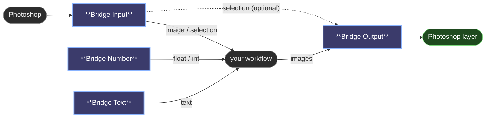

# Bridge nodes

The nodes come in two halves. Bridge Input brings pixels in from Photoshop, and Bridge Output sends the result back. Number and Text turn into controls in the Photoshop panel. Put each one wherever your workflow needs that piece: there's no single "Photoshop node" that everything has to hang from.

Photoshop only sends what the open workflow uses, and only when it changes. An Input node whose layer you didn't touch keeps its previous output, so ComfyUI skips everything downstream of it.

## Bridge Input

What to read from Photoshop: the whole document, or one layer or group that stays the same no matter which layer is active while you paint.

- **Document**: which Photoshop document to read. **Active document** (the default) follows whatever you're working in. Pick an open document from the list to always read that one, even while another is active. It's bound by id and, when you reopen it in another session, by name. **Use active** in the panel sets it too.
- **Photoshop source**: **Whole document** (the default) is every visible layer merged, the way you see it. Or pick a layer or group from the list (groups end in `/`), or select it in Photoshop and press **Use active** in the panel; **Document** in the panel goes back to the whole document. A layer is bound by id, so renaming it keeps the binding; if the id is gone (another document), the layer's path is used instead.
- `image`, `alpha`: the pixels and transparency, placed where they sit in the document, so a layer lines up with the whole document and with the selection.
- `selection`: a mask at document size, white where selected and black everywhere else. It doesn't depend on **Photoshop source**. Photoshop only sends it while this output is connected, so a workflow that doesn't use it isn't re-run when you select something.
- **Selection source**: what `selection` holds. **Current selection** (the default) is the live selection or Quick Mask; with nothing selected it's all black. Or pick a saved selection: an alpha channel (`Channel: Face`) or a path (`Path: Outline`), so mattes you prepared beforehand go straight into the workflow. You choose it in the Photoshop panel, from the dropdown under the input, so switching mattes while you retouch never takes you back to ComfyUI; the node has the same list. Saved ones are bound by id like layers, and reading them leaves your own selection and history untouched. A path is read anti-aliased, with no feather.
- A group arrives as Photoshop would flatten it: only its visible layers, with their opacity and blend modes. Your document and its history are left untouched.

### Inpainting a selection

Use **😺NKD Inpaint Crop** and **😺NKD Inpaint Stitch** from [NKD Basic Tools](https://github.com/Nekodificador/ComfyUI-NKD-Basic-Tools): they crop around the mask at the model's resolution and blend the result back.

1. Bridge Input's `image` and `selection` go into Inpaint Crop's `image` and `mask`.
2. Sample the crop, then give it to Inpaint Stitch with Inpaint Crop's `crop_data`.
3. Stitch's `image` goes to Bridge Output, with the same `selection` in Output's `mask`: the new layer is transparent outside the selection, so only the selected area changes.

## Bridge Number and Bridge Text

Each one shows up in the Photoshop panel as a control named after `name`: a slider for Number, a text box for Text. Moving the slider writes the value into the node in your ComfyUI tab, so what you see in both places is always the same value, and it's saved with the workflow.

Number:
- `name`: the label in the panel.
- `value`, `min`, `max`, `step`: the slider.
- Outputs both `float` and `int` (rounded), so it can drive denoise or a seed.

Text:
- `name`: the label in the panel.
- `text`: the text. Outputs it as a string.

## Bridge Output

Sends the image back to Photoshop. It runs on every execution, even when nothing upstream changed, so pressing Generate always delivers. Whatever the destination, the result also shows up in the panel.

- `images`: what to send. Only the first image of a batch is used.
- **Document**: where the result goes. **Active document** (the default) sends it back to the document its pixels came from. Pick another open document to paint in one and get the result in the other, for example a smart object's contents. The result is scaled to fit that document's canvas.
- `save_after_write`: saves that document after writing. Turn it on when it's a smart object's contents (the `.psb` that opens when you edit it), so the smart object in the parent document updates by itself.
- **Destination**: one list that decides where the result goes. What you pick sets the behaviour:
  - **Panel only**: shown in the panel, the document isn't touched. **Add preview as layer** can keep it.
  - **+ New layer**: creates a layer on the first run, and from then on the node is bound to that layer.
  - **+ New group**: creates a group on the first run and binds to it.
  - A layer (`Background`, `Character/Hair`): replaced on every run.
  - A group, shown with a trailing slash (`Characters/`): a new layer inside on every run, so you keep the variations side by side. While **Live** is on, the latest one is replaced instead, so painting doesn't pile up layers.
- `name`: how the layers it creates are called. **Insert variable** adds one at the end:
  - `{n}`: the run number inside the group (1, 2, 3…).
  - `{seed}`: the sampler's seed.
  - `{date}`, `{time}`: when it ran.
  - `{doc}`: the document's name.
  - Any Bridge Text or Bridge Number by its name, such as `{Prompt}` or `{Denoise}`. Long values are cut to 40 characters.
- `mask` (optional): transparency for the written layer. Give it Bridge Input's `selection` and only the selected area changes.

The destination is bound by id, like Bridge Input, so renaming the layer or group doesn't break it. If it gets deleted, the next run creates it again. With **Active document**, the result goes back to the document its pixels came from, even if you've switched to another one while it was generating. If the target document has been closed, nothing is written and the panel tells you.

### Painting in one document, results in another

Set Bridge Input's **Document** to the one you paint in and Bridge Output's **Document** to the one that should receive the result. A smart object works well as the target: edit its contents once so its `.psb` is open, pick it in the Output, and tick `save_after_write`. Live only re-runs when you change the document an Input reads, so working on the target never triggers a run.

In the panel's **Inputs & outputs** tab every Output has its own ▶ to run just that branch, a line saying where the result will land, **Use active** to send it to the layer or group selected in Photoshop, **Panel only**, and the name field with the variables as clickable chips.

---

[← All 😺NKD Comfy Bridge nodes](../README.md)
